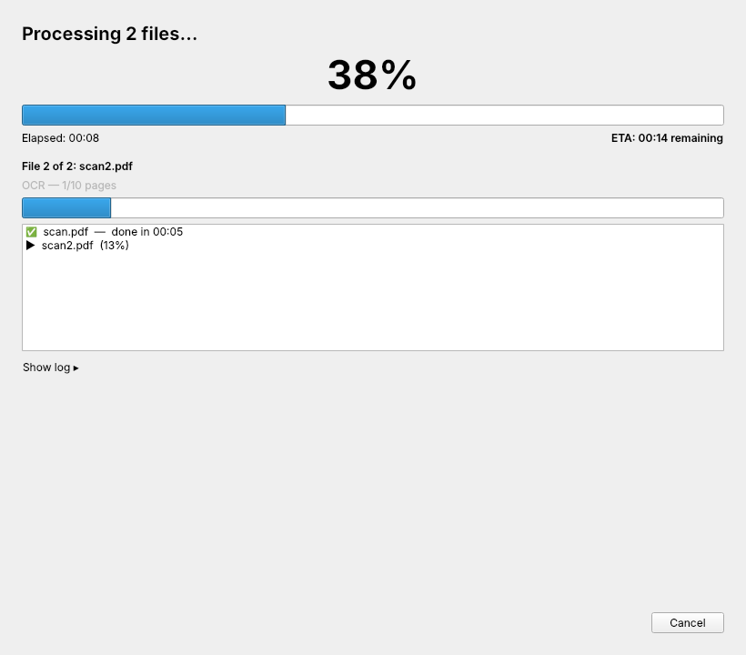

# OCRmyPDF GUI



A small desktop app for [OCRmyPDF](https://github.com/ocrmypdf/OCRmyPDF).

1. **Select files**: drag & drop PDFs, images or whole folders, or click to browse.
2. **Options**: languages, how to handle existing text, output type (PDF/A or PDF), output folder/suffix,
   sidecar .txt, deskew/rotate/clean, optimization, metadata, Tesseract settings, and a free-form
   "extra arguments" box. Shows the exact `ocrmypdf` command it will run. Your settings are remembered.
3. **Progress**: overall percentage, ETA, current file and stage (e.g. "OCR — 4/10 pages"),
   per-file status, log, and Cancel.

## All-in-one Flatpak (Linux)

The `flatpak/` folder builds a self-contained app that includes Python, Qt, OCRmyPDF, Tesseract,
Ghostscript and unpaper, so nothing else needs to be installed. English is bundled; other
languages can be downloaded from inside the app (**Get more languages…**).

```bash
flatpak remote-add --user --if-not-exists flathub https://dl.flathub.org/repo/flathub.flatpakrepo
flatpak install --user flathub org.flatpak.Builder
cd flatpak
flatpak run org.flatpak.Builder --user --install --install-deps-from=flathub --force-clean build io.github.HoodNewsSanaa.OCRmyPDF_GUI.yml
flatpak run io.github.HoodNewsSanaa.OCRmyPDF_GUI
```

Or download `ocrmypdf-gui.flatpak` from the [Releases page](https://github.com/HoodNewsSanaa/OCRmyPDF-GUI/releases) and install it:

```bash
flatpak install --user ocrmypdf-gui.flatpak
```

To update the bundled Python packages, run `flatpak/generate-python-deps.py`.

## Install without Flatpak

You need Tesseract and Ghostscript installed system-wide (unpaper is optional, for "Clean"):

- macOS: `brew install ocrmypdf` (installs all dependencies)
- Debian/Ubuntu: `sudo apt install tesseract-ocr ghostscript unpaper` (+ `tesseract-ocr-deu` etc. for more languages)
- Windows: install Tesseract (UB Mannheim build) and Ghostscript, and make sure both are on PATH

Then:

```bash
pip install -r requirements.txt
python3 ocrmypdf_gui.py            # or: python3 ocrmypdf_gui.py file1.pdf file2.pdf
```

## How progress works

Each file is processed by `python -m ocrmypdf` in a separate process. `gui_progress_plugin.py` is
an OCRmyPDF plugin that reports progress events as JSON lines. The GUI maps the stages (scanning,
OCR, PDF/A conversion, optimization) onto a 0–100% scale per file, weights files by page count,
and works out the ETA from the overall rate.

## Credits and licenses

This GUI is licensed under the [Mozilla Public License 2.0](LICENSE).

It is a front end for these projects, which do the actual work. The Flatpak bundles them, each under its own license:

| Project | What it does here | License |
|---|---|---|
| [OCRmyPDF](https://github.com/ocrmypdf/OCRmyPDF) by James R. Barlow and contributors | The OCR pipeline | MPL-2.0 |
| [Tesseract OCR](https://github.com/tesseract-ocr/tesseract) | Text recognition | Apache-2.0 |
| [tessdata_fast](https://github.com/tesseract-ocr/tessdata_fast) | Language models | Apache-2.0 |
| [Leptonica](https://github.com/DanBloomberg/leptonica) | Image library used by Tesseract | BSD-2-Clause |
| [Ghostscript](https://www.ghostscript.com/) by Artifex Software | PDF rendering and PDF/A conversion | AGPL-3.0 |
| [unpaper](https://github.com/unpaper/unpaper) | Page cleaning | GPL-2.0 |
| [Qt for Python (PySide6)](https://www.qt.io/qt-for-python) | User interface | LGPL-3.0 |

Source code for every bundled component is pinned in
[`flatpak/io.github.HoodNewsSanaa.OCRmyPDF_GUI.yml`](flatpak/io.github.HoodNewsSanaa.OCRmyPDF_GUI.yml).

This project is not affiliated with or endorsed by the OCRmyPDF project.
